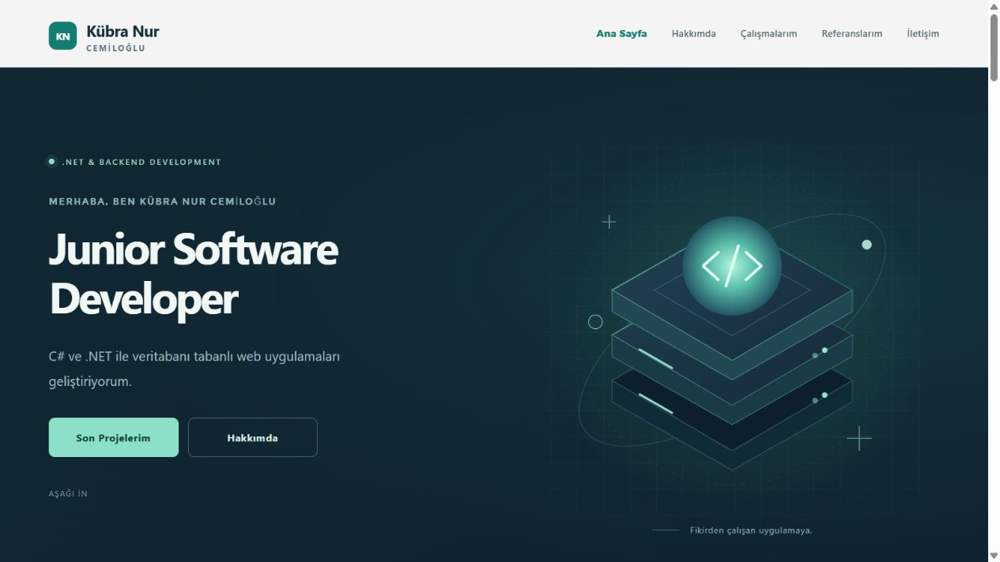
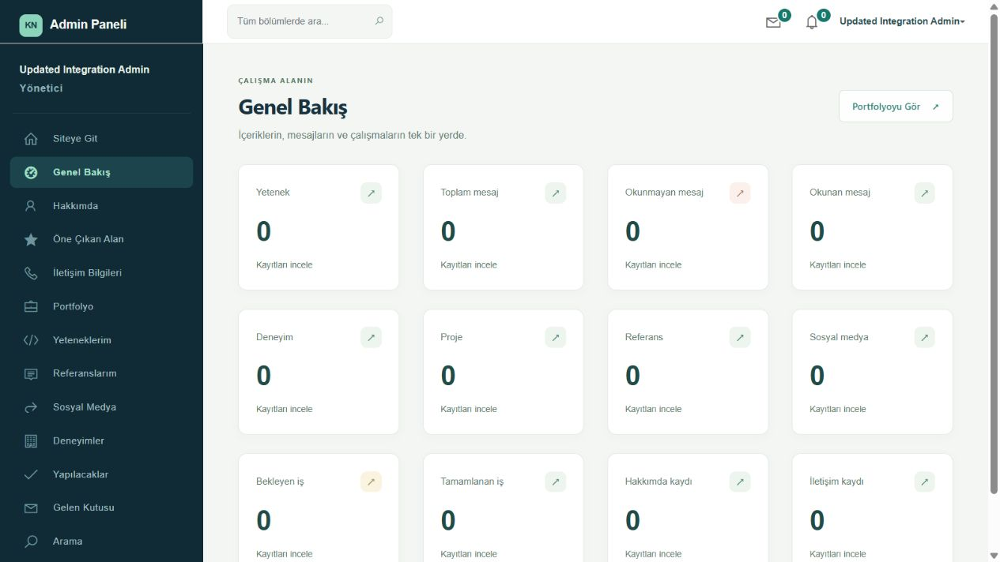

# ASP.NET Core MVC ile Kişisel Portfolyo

Kübra Nur Cemiloğlu'nun çalışmalarını, yetkinliklerini ve deneyimlerini sergilemek için geliştirilen kişisel portfolyo ve yönetim paneli uygulamasıdır.

Proje, Murat Yücedağ'ın Udemy eğitimi ve [MyPortolioUdemy](https://github.com/MuratYucedag/MyPortolioUdemy) projesi temel alınarak kişiselleştirilmiş ve geliştirilmiştir. Kursun MVC ve Entity Framework yapısı korunarak eksik yönetim ekranları tamamlanmış; arama, iletişim formu, yönetici hesabı ve yeni görsel tasarım eklenmiştir.

## Proje Hakkında

Uygulama ziyaretçi ve yönetim olmak üzere iki bölümden oluşur. Ziyaretçiler projeleri, yetenekleri, deneyimleri ve referansları inceleyebilir; iletişim formundan mesaj gönderebilir. Yönetici ise oturum açarak bu içerikleri düzenleyebilir, gelen mesajları yönetebilir ve yapılacak işlerini takip edebilir.

İçerikler SQL Server veritabanında tutulur. Yönetim panelindeki değişiklikler ziyaretçi sayfasındaki ilgili bölümlere yansır. Lacivert, petrol yeşili ve kırık beyaz renkleriyle iki bölüm arasında ortak bir tasarım dili kullanılmıştır.

## Kullanılan Teknolojiler

- C#
- ASP.NET Core MVC
- Entity Framework Core
- Microsoft SQL Server / LocalDB
- Razor View Engine ve Tag Helpers
- ViewComponent
- Cookie Authentication
- ASP.NET Core PasswordHasher
- HTML5 ve CSS3
- Bootstrap
- JavaScript ve jQuery
- AJAX

## Mimari ve Kullanılan Yaklaşımlar

- **MVC:** İsteklerin controller, veri modelleri ve Razor görünümleri üzerinden yönetilmesi.
- **Code First ve Migration:** Veritabanı şemasının C# modellerinden oluşturulması ve değişikliklerin migration dosyalarıyla takip edilmesi.
- **ViewComponent:** Ziyaretçi sayfasının hakkımda, projeler, yetenekler ve iletişim gibi bağımsız bölümlere ayrılması.
- **Form Modelleri:** Giriş, profil ve iletişim formlarının kendilerine ait modellerle alınması.
- **Ortak Yönetim Controller'ı:** Yönetim ekranlarında oturum kontrolünün ortak bir üst sınıf üzerinden uygulanması.
- **Sunucu Tarafı Doğrulama:** Zorunlu alanlar, e-posta biçimi, bağlantılar ve yetenek yüzdesinin kontrol edilmesi.
- **Post/Redirect/Get:** Başarılı form işlemlerinden sonra liste ekranına yönlendirme yapılması.

## Kullanılan Framework Sürümleri

| Teknoloji | Sürüm |
|---|---|
| .NET / ASP.NET Core | 9.0 |
| Entity Framework Core | 9.0.21 |
| EF Core SQL Server Provider | 9.0.21 |

## Özellikler

### Ziyaretçi Sayfası

- Karşılama ve kişisel tanıtım alanı
- Hakkımda ve öne çıkan yetenekler
- Eğitim ve deneyim zaman çizelgesi
- Proje görselleri ve açıklamaları
- Referanslar ve sosyal medya bağlantıları
- Güncel içerik istatistikleri
- Yönetici gelen kutusuna mesaj kaydeden iletişim formu
- Mobil ekranlara uyumlu tasarım

### Yönetim Paneli

- İlk yönetici hesabını oluşturma ve oturum açma
- Hakkımda, öne çıkan alan ve iletişim bilgilerini düzenleme
- Deneyim, proje, yetenek, referans ve sosyal medya kayıtlarını ekleme, güncelleme ve silme
- Gelen mesajları görüntüleme, okundu/okunmadı işaretleme ve silme
- Yapılacak iş ekleme ve tamamlanma durumunu yönetme
- Yönetim bölümlerinde arama
- Veritabanından hesaplanan istatistikler ve bildirimler
- Profil ve şifre değiştirme

## Ekran Görüntüleri

### Portfolyo Ana Sayfası



### Yönetim Paneli

Panel görüntüsü ayrı test ortamından alınmıştır; kartlardaki değerler test verilerini temsil eder.



## Kurulum

Gereksinimler: .NET 9 SDK, SQL Server LocalDB ve EF Core 9 uyumlu `dotnet-ef` aracı.

Depoyu indirdikten sonra `.sln` dosyasının bulunduğu klasörde aşağıdaki komutları çalıştırın:

```powershell
dotnet restore
dotnet tool install --global dotnet-ef --version 9.0.21
dotnet ef database update
dotnet run --launch-profile http
```

`dotnet-ef` zaten kuruluysa araç yükleme adımı atlanabilir. Kurulu sürümün projedeki EF Core sürümüyle uyumlu olması gerekir.

- Portfolyo: `http://localhost:5284/`
- Yönetim: `http://localhost:5284/Account/Login`
- İlk hesap kurulumu: `http://localhost:5284/Account/Setup`

İlk hesap yalnızca yerel bilgisayardan oluşturulur. İlk yönetici oluşturulduktan sonra kurulum ekranı kapanır. Hazır kullanıcı adı veya şifre bulunmaz.

Varsayılan bağlantı `(localdb)\MSSQLLocalDB` sunucusundaki `MyPortfolioDb` veritabanıdır. Farklı bir bağlantı için `ConnectionStrings__Portfolio` ortam değişkeni kullanılabilir. Veritabanı yedeği ve kişisel hesap verileri bu depoya dahil değildir; tablolar migration komutuyla oluşturulur.

## Proje Yapısı

```text
Controllers/       İstekler ve yönetim işlemleri
DAL/Context/       Entity Framework veritabanı bağlantısı
DAL/Entities/      Veritabanı modelleri
Migrations/        Veritabanı şema değişiklikleri
Models/            Form ve görünüm modelleri
ViewComponents/    Ziyaretçi sayfası bileşenleri
Views/             Razor görünümleri
wwwroot/           CSS, JavaScript ve görseller
docs/images/       README ekran görüntüleri
```

## Kaynak ve Teşekkür

- Eğitim ve başlangıç projesi: [Murat Yücedağ — MyPortolioUdemy](https://github.com/MuratYucedag/MyPortolioUdemy)
- Arayüz temelleri: Hola / Styleshout ve Ready Bootstrap Dashboard

Kullanılan temaların kaynak ve lisans dosyaları ilgili klasörlerinde korunmuştur.
